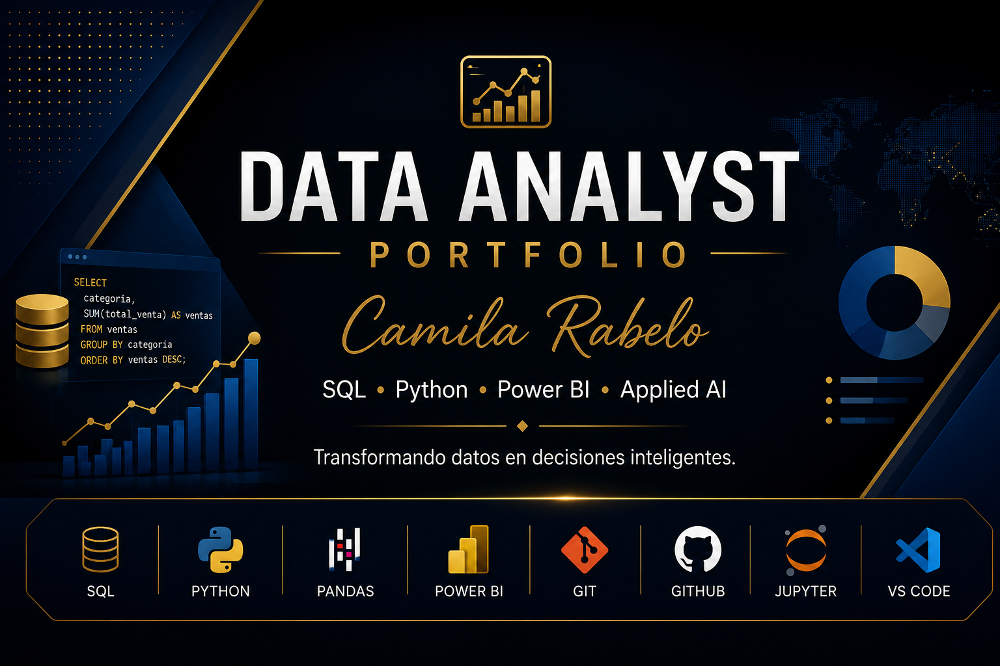

<p align="center">
  
</p>

<h1 align="center">📊 Data Analyst Portfolio</h1>

<p align="center">
  
  
  
  
  
  
  
  
</p>

<p align="center">
  Portfolio de proyectos de análisis de datos con <strong>Python · SQL · SQLite · Pandas</strong><br>
  Resolución de casos de negocio reales mediante consultas, notebooks y visualizaciones interactivas.
</p>

---

## 👋 Sobre mí

Soy **Bianca Merchán Torres**, estudio en la universidad Nacional De Ingeniería la carrera de Ciencias de la computación, avanze este proyecto combinando SQL, Python y visualización.

📍 Alicante, España &nbsp;·&nbsp; 💼 [LinkedIn](www.linkedin.com/in/bianca-merchan-torres-231007371)

---

## 🔍 Habilidades

- **SQL** — SELECT, JOIN, GROUP BY, HAVING, subconsultas, CASE WHEN, COALESCE
- **Python** — Análisis exploratorio, limpieza de datos, visualización con Matplotlib
- **Pandas** — Manipulación y transformación de DataFrames
- **SQLite** — Diseño y consulta de bases de datos relacionales
- **Power BI** — Dashboards interactivos *(en desarrollo)*
- **Git & GitHub** — Control de versiones y publicación de proyectos

---

## ➤ [Análisis Comercial — DataRetail Levante, S.L. 🏢📊](consultas_sql/informe_ventas_completo.sql)

Caso práctico integrador basado en una empresa del sector tecnológico con datos reales de clientes, ventas, productos, tiendas y devoluciones.

### 🎯 Objetivos del análisis

- Analizar el comportamiento mensual y trimestral de ventas
- Identificar los productos y clientes más rentables
- Calcular KPIs: facturación total, ticket medio, margen bruto
- Segmentar clientes por volumen de compra (VIP / Frecuente / Ocasional)
- Detectar productos sin ventas y clientes inactivos

### 📁 Archivos del proyecto

| Archivo | Descripción | Tecnología |
|---|---|---|
| [`consultas_sql/informe_ventas_completo.sql`](consultas_sql/informe_ventas_completo.sql) | Consultas SQL organizadas en 6 secciones: KPIs, clientes, productos, evolución temporal, JOINs y subconsultas avanzadas | SQL · SQLite |
| [`notebooks/analisis_ventas_completo.ipynb`](notebooks/analisis_ventas_completo.ipynb) | Análisis completo con Python: conexión a SQLite, KPIs, gráficos y conclusiones de negocio | Python · Pandas · Matplotlib |
| [`dashboard/index.html`](dashboard/index.html) | Dashboard interactivo con datos reales: evolución mensual, top productos, canal de venta y ranking de clientes | HTML · Chart.js |
| [`bases_datos/ventas.db`](bases_datos/ventas.db) | Base de datos SQLite con 8 tablas: Clientes, Productos, Ventas, LineasVenta, Empleados, Proveedores, Categorías, Compras | SQLite |

### 📌 Resumen de resultados

> **24 ventas registradas · 12 clientes · 17.786,99 € facturados · Ticket medio 741 €**

- 💰 **Mejor mes:** Junio 2025 — 3.857 €
- 🥇 **Producto estrella:** Portátil Lenovo ThinkBook — 4.602 € generados
- 🏆 **Cliente top:** Logística Sureste — 3.240 € en compras
- 📦 **Canal más rentable:** Presencial — 8.698 € (49 % de la facturación)
- 📈 **Margen bruto del negocio:** superior al 55 %

### 🛠 Técnicas SQL aplicadas

```sql
-- Segmentación de clientes con CASE WHEN
SELECT
    c.NombreCliente,
    ROUND(SUM(lv.Cantidad * lv.PrecioUnitario * (1 - lv.Descuento/100.0)), 2) AS TotalComprado,
    CASE
        WHEN SUM(lv.Cantidad * lv.PrecioUnitario * (1 - lv.Descuento/100.0)) >= 2000 THEN 'VIP'
        WHEN SUM(lv.Cantidad * lv.PrecioUnitario * (1 - lv.Descuento/100.0)) >= 1000 THEN 'Frecuente'
        ELSE 'Ocasional'
    END AS SegmentoCliente
FROM Clientes c
JOIN Ventas v       ON c.IdCliente = v.IdCliente
JOIN LineasVenta lv ON v.IdVenta   = lv.IdVenta
GROUP BY c.IdCliente
ORDER BY TotalComprado DESC;
```

*Ver el [script completo](consultas_sql/informe_ventas_completo.sql) con las 6 secciones de análisis.*

---

## 📁 Estructura del repositorio

```
data-analyst-portfolio/
│
├── bases_datos/
│   └── ventas.db                        ← Base de datos SQLite (caso DataRetail)
│
├── consultas_sql/
│   ├── informe_ventas_completo.sql      ← ✅ Análisis SQL completo (6 secciones)
│   ├── sesion1.sql … sesion6.sql        ← Práctica progresiva por sesión
│   └── Ejercicio *.sql                  ← Ejercicios de consolidación
│
├── notebooks/
│   ├── analisis_ventas_completo.ipynb   ← ✅ Análisis Python completo
│   ├── Informe Comercial Ventas.ipynb   ← Informe de KPIs con Pandas
│   └── sesion*.ipynb                    ← Práctica por sesión
│
├── dashboard/
│   └── index.html                       ← ✅ Dashboard interactivo (Chart.js)
│
├── datasets/
│   ├── csv/                             ← Datos de clientes y stock
│   ├── excel/                           ← Datasets con errores para limpieza
│   └── Json/                            ← Reseñas de clientes
│
└── imagenes/
    └── banner-data-analyst.png
```

---

## 🚀 Próximos proyectos

- 📊 Dashboard en Power BI sobre los mismos datos
- 🐍 Automatización de informes con Python
- 📈 Visualizaciones avanzadas con Plotly / Seaborn
- 🤖 IA aplicada al análisis de datos

---

<p align="center">
  ⭐ Si este portfolio te resulta útil, considera darle una estrella al repositorio.
</p>
